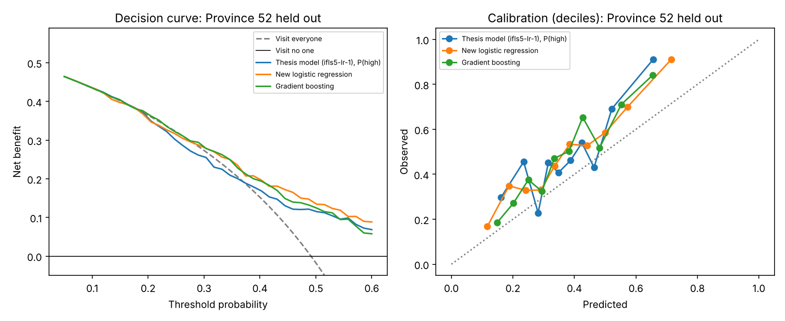
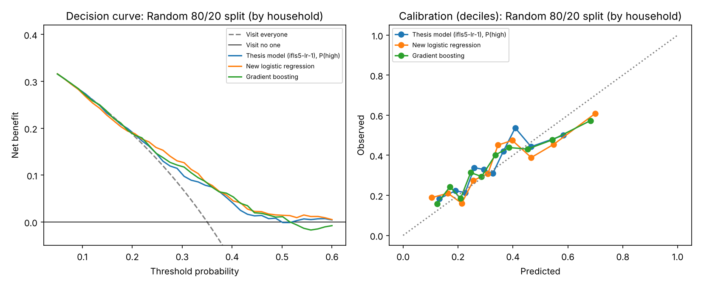
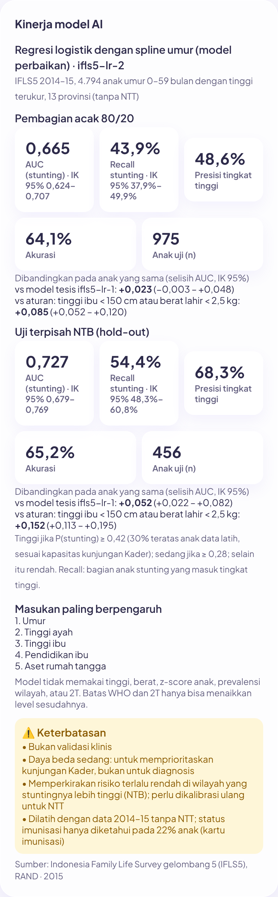
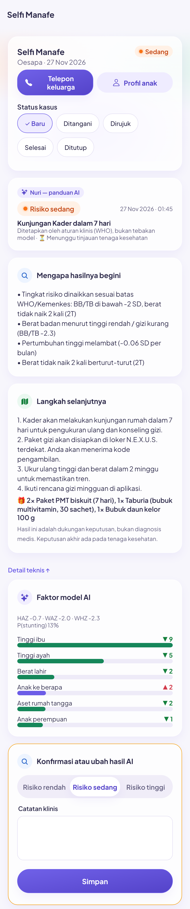
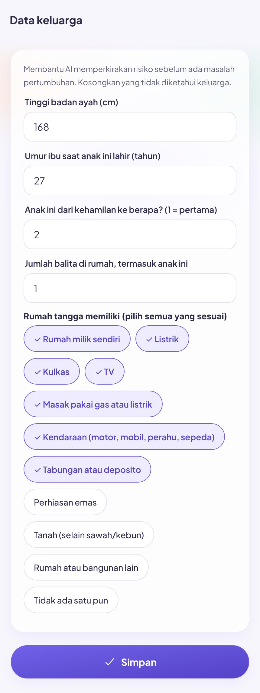
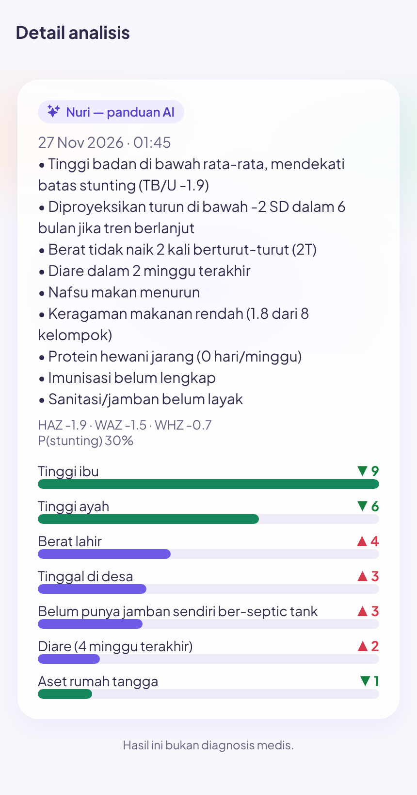

# How to use this file

1. **Part A** is a prompt. Paste it into Claude (or another assistant) together with your current Chapter 4 (and
   Chapters 1, 3 and 5 if you want them updated too). It tells the assistant how to fold the new results in without
   overstating them.
2. **Part B** is ready-to-use thesis text with tables and figures. You can also paste it in yourself.
3. **Part C** lists every number with its source, so you or an examiner can check it.

All figures come from the code in the repository (`ml/`, `backend/app/ai/riskModel/`). They were computed on your IFLS5
files. Nothing was tuned on the test sets, and a variant that was rejected is reported (Section B.6).

\newpage

# Part A. Prompt

Copy everything in the box below, then attach or paste your thesis chapters after it.

```text
You are helping me revise my bachelor's/master's thesis on NutriSense, an app for stunting prevention in
Nusa Tenggara Timur (NTT), Indonesia. My thesis currently presents the risk model "ifls5-lr-1": a multinomial
logistic regression trained on IFLS5 2014-15 (16 inputs, levels low/medium/high, high if P(high) >= 0.26),
evaluated on a random 80/20 split and an NTB hold-out (AUC 0.681 and 0.678).

I have built and evaluated an improved model, "ifls5-lr-2", which the app now uses. Its methods, results, figures
and limitations are in the attached document "Part B". Please revise my thesis to include it.

Rules:
1. Keep ifls5-lr-1 in the thesis as the original (baseline) model. Present ifls5-lr-2 as an improvement built and
   evaluated after it, in a new subsection of Chapter 4 (e.g. "4.x Model improvement"), placed after the current
   evaluation of ifls5-lr-1. Update the system/implementation sections where the app's model is described.
2. Use only numbers from Part B. Do not round differently, do not invent numbers, and keep every confidence
   interval next to its estimate.
3. Be exact about what is and is not significant:
   - ifls5-lr-2 beats the simple rule (mother < 150 cm or birth weight < 2.5 kg) in both settings (significant).
   - The five new inputs improve the model in both settings (significant).
   - ifls5-lr-2 beats ifls5-lr-1 on the NTB hold-out (+0.052, significant) but NOT significantly on the random split
     (+0.023, 95% CI -0.003 to +0.048). Say this plainly.
   - ifls5-lr-1 may have seen some test children (it was trained on the random split of the same data), so its
     figures in the comparison are optimistic; mention this once.
4. Keep the claims modest: AUC 0.67-0.73 is modest discrimination. The model prioritises Kader visits; it does not
   diagnose. The WHO z-score rules on measured growth stay in charge and can only raise the level.
5. Keep all limitations from Part B (no NTT data, 2014-15 data, cross-sectional target, immunisation mostly unknown,
   not a clinical validation, needs threshold recalibration for NTT).
6. Explain the two design decisions in Part B: (a) no district input; (b) no missing-value flags (false reassurance
   for children with missing data). These show careful, safety-minded design; do not leave them out.
7. Write in the same language, tense, voice, citation style and numbering style as my thesis. Use my table and
   figure numbering (continue from the existing numbers) and update cross-references. Replace Figure 4.15c (the
   app's model performance panel) with the new screenshot from Part B.
8. Also update, briefly: the abstract (one or two sentences on ifls5-lr-2), the conclusion (main findings and
   limitations), and future work (NTT recalibration, predicting future growth faltering from repeated measurements).
9. Show me the changes section by section, marking new and changed text, before giving me the full revised chapter.
   Ask me if anything in my thesis conflicts with Part B instead of guessing.

Citations to use or keep: Strauss, J., Witoelar, F., & Sikoki, B. (2016). The Fifth Wave of the Indonesia Family Life
Survey (IFLS5): Overview and Field Report. RAND (WR-1143/1-NIA/NICHD). WHO Multicentre Growth Reference Study Group
(2006). WHO Child Growth Standards. Kemenkes RI (2020). Permenkes No. 2 Tahun 2020 tentang Standar Antropometri Anak.
Vickers, A. J., & Elkin, E. B. (2006). Decision curve analysis. Medical Decision Making, 26(6), 565-574.
Pedregosa, F. et al. (2011). Scikit-learn: Machine learning in Python. JMLR, 12, 2825-2830.
```

\newpage

# Part B. Thesis text, tables and figures

## B.1 Why a second model

The thesis model ifls5-lr-1 had modest discrimination (AUC 0.68), did not recognise the medium level well, and used
the district as an input although every NTT district was unseen in training. It also had no inputs about the father or
the household's economic situation, although both are established determinants of child growth. A second model was
therefore built on the same IFLS5 data, with the aim of a better-generalising, safer model that a Kader can feed with
answers collected at registration.

## B.2 Data

The child-level dataset was rebuilt from the raw IFLS5 household files (RAND). It contains 4,794 children aged 0–59
months with a measured height and a birth date, from 4,299 households in 13 provinces (no NTT). Height-for-age z-scores
(HAZ) were computed with the WHO Child Growth Standards (WHO, 2006), using the same code as the app. Children with
|HAZ| > 6 were excluded as implausible. Of the children, 35.6% were stunted (HAZ < −2). Survey weights were the IFLS5
cross-section health-measurement weights (`pwt14usxa`).

The rebuilt dataset was checked against the thesis model. On it, ifls5-lr-1 has an AUC of 0.692 for stunting (thesis:
0.681). The means of the inputs match the means stored in the model (age 30.4 vs 29.5 months, birth weight 3,140 vs
3,134 g, antenatal visits 9.3 vs 9.2, mother's education 2.44 vs 2.46). The thesis dataset had 5,202 children. The
difference comes from requiring a measured height, a birth date and a plausible HAZ.

## B.3 Inputs

ifls5-lr-2 uses 20 inputs, all known before the child is measured (Table B1). The child's height, weight and z-scores,
the district, regional prevalence and the 2T rule are not inputs.

**Table B1. Inputs of ifls5-lr-2 and their source in IFLS5 and in the app.**

| Input | IFLS5 source | In the app |
|---|---|---|
| Age (months, exact) | Birth date (PTRACK), interview date | Birth date, measurement date |
| Sex | Roster AR07 | Registration |
| Birth weight (g), < 2,500 g | Pregnancy history CH24 | Registration (KIA book) |
| Mother's height (cm) | Health measurement US04 | Pregnancy record |
| Mother's education (0–4) | Roster AR16 | Pregnancy record |
| Antenatal visits | CH16a–c | ANC visits of the linked pregnancy |
| Mother anaemic (Hb < 12 g/dL) | US13 | Hb of the linked pregnancy |
| Exclusive breastfeeding to 6 months | CH24c–d (first water, first food) | ASI tracker or registration |
| Diarrhoea, last 4 weeks | Book 5 morbidity (IA) | Symptom reports |
| Cough with difficult breathing, last 4 weeks | Book 5 morbidity (CA and DA) | Symptom reports (cough and fast/difficult breathing) |
| Basic immunisation complete | Vaccination card (RJA28) | Buku KIA records |
| Improved drinking water | KR13 (piped, pump well, rain, bottled) | Registration |
| Own toilet with septic tank | KR20 | Registration |
| Urban | SC05 | Village |
| **Father's height (cm)** | US04 of the father | **New: family details** |
| **Mother's age at the birth** | AR09 of the mother minus the child's age | **New: family details** |
| **Birth order** | CH05 | **New: family details, or the pregnancy's gravida** |
| **Children under 5 at home** | Roster | **New: family details** |
| **Household assets (0–10)** | KR03, KR11, KR23, KR24, KR24a; HR01 (B, C, E, G, J) | **New: 10-item checklist** |

The five new inputs (bold) were chosen before any results were seen, as information a Kader can ask at registration.

## B.4 Model and evaluation

ifls5-lr-2 is a logistic regression for stunting (HAZ < −2) with the following design:

- **Age:** a cubic spline with 5 knots, because risk rises steeply between 6 and 24 months.
- **Other inputs:** numeric inputs standardised; unknown values imputed with the training median (numeric) or the most common value (0/1).
- **Regularisation:** L2, with its strength chosen by 5-fold cross-validation grouped by household (C = 0.19).
- **Software and weights:** fitted with survey weights in scikit-learn (Pedregosa et al., 2011).

Levels follow Kader capacity rather than a fixed probability:

| Level | Rule | Threshold |
|---|---|---|
| High | P(stunting) in the top 30% of the training children | P ≥ 0.4218 |
| Medium | Top 60% | P ≥ 0.2837 |
| Low | The rest | |

The thresholds are fixed on the training data, so in an area with more stunting, more children are classed high. As
before, the WHO/Kemenkes cut-offs, oedema, 2T and danger signs are applied after the model and can only raise the
level.

The evaluation used the thesis's two settings: a random 80/20 split grouped by household, and NTB (province 52) held
out. Each model was trained without the test children. ifls5-lr-2 was compared with:

- the thesis model ifls5-lr-1;
- the same model without the five new inputs;
- gradient boosting with the same inputs;
- a simple rule: mother < 150 cm or birth weight < 2.5 kg.

Confidence intervals come from bootstrap resampling of households. Differences in AUC were tested with a paired
household bootstrap of 1,000 resamples, so both models are judged on the same children. Decision curves (Vickers &
Elkin, 2006) and calibration plots were also drawn.

## B.5 Results

**Table B2. Discrimination for stunting (AUC, 95% CI, 300 household resamples).**

| Model | Random split (n = 975) | NTB held out (n = 456) |
|---|---|---|
| Thesis model ifls5-lr-1 | 0.641 (0.596–0.681) | 0.674 (0.611–0.719) |
| **ifls5-lr-2** | **0.665 (0.622–0.711)** | **0.727 (0.675–0.774)** |
| Gradient boosting, same inputs | 0.655 (0.615–0.695) | 0.723 (0.672–0.765) |
| Rule: mother < 150 cm or birth weight < 2.5 kg | 0.581 (0.541–0.622) | 0.574 (0.517–0.622) |

*ifls5-lr-1 was trained on the random split of IFLS5, so it may have seen some test children (and all of NTB); its
figures here are optimistic. The app's model card gives ifls5-lr-2's AUC with 1,000 resamples: 0.665 (0.624–0.707) and
0.727 (0.679–0.769).*

**Table B3. Paired comparisons: AUC difference (95% CI), 1,000 household resamples.**

| Comparison | Random split | NTB held out |
|---|---|---|
| ifls5-lr-2 vs rule | **+0.085** (+0.052 to +0.120) | **+0.152** (+0.113 to +0.195) |
| ifls5-lr-1 vs rule | **+0.061** (+0.025 to +0.097) | **+0.100** (+0.060 to +0.141) |
| ifls5-lr-2 vs the same model without the five new inputs | **+0.024** (+0.007 to +0.040) | **+0.025** (+0.004 to +0.047) |
| ifls5-lr-2 vs ifls5-lr-1 | +0.023 (−0.003 to +0.048) | **+0.052** (+0.022 to +0.082) |

*Bold: the 95% CI excludes zero.*

**Table B4. ifls5-lr-2 as deployed (thresholds fixed on the training data).**

| Setting | Flagged high | Recall (95% CI) | Precision | Accuracy | Brier | Calibration slope |
|---|---|---|---|---|---|---|
| Random split | 31.6% | 43.9% (37.9–49.9%) | 48.6% | 64.1% | 0.212 | 0.81 |
| NTB held out | 39.1% | 54.4% (48.3–60.8%) | 68.3% | 65.2% | 0.222 | 1.09 |

*Recall: the share of stunted children classed high. Precision: the share of children classed high who are stunted.*

The most important inputs, measured by the drop in AUC when an input is unknown for every test child, were age,
father's height, mother's height, mother's education and household assets.

{width=100%}

{width=100%}

## B.6 Two design decisions

**No district input.** ifls5-lr-1 had 74 district columns. Every NTT district is unseen, so they add nothing for NTT
children. ifls5-lr-2 uses no district.

**No missing-value flags.** A variant with 0/1 "value missing" flags performed about the same:

| | AUC, random split | AUC, NTB held out | vs ifls5-lr-1 (random) | vs ifls5-lr-1 (NTB) |
|---|---|---|---|---|
| With flags | 0.662 | 0.719 | +0.021 | +0.044 |
| Without flags (ifls5-lr-2) | 0.665 | 0.727 | +0.023 | +0.052 |

It was rejected for safety. In the survey, a value is missing for reasons that carry risk information; for example,
the father was not there to be measured. In the app, a value is missing because nobody has asked yet. With flags, a
child with no data scored P(stunting) = 0.17, "low", which is false reassurance. Without flags, the same child scores
0.34 ("medium") and is sent to a health worker for review.

## B.7 Discussion

Three findings support the use of a model in NutriSense:

1. **A model adds value over a checklist.** ifls5-lr-2 ranks children better than the simple rule "mother < 150 cm or
   birth weight < 2.5 kg", by +0.085 and +0.152 AUC.
2. **The new questions help.** The five questions a Kader can ask at registration (father's height, mother's age at the
   birth, birth order, children under 5 and an asset checklist) improve the model significantly in both settings.
3. **It generalises better.** ifls5-lr-2 does better in a province it never saw (NTB: +0.052 over ifls5-lr-1), which
   matters for use in NTT.

Gradient boosting was not better than logistic regression, which supports keeping the interpretable model. Its
explanations are shown to health workers in the app.

The gain over ifls5-lr-1 on the random split (+0.023) was not significant. Discrimination stays modest (AUC
0.67–0.73), so the model is a tool for prioritising Kader visits, not for diagnosis. In the decision curve, the model
beats "visit everyone" only above a threshold probability of about 0.35, which is the situation the app is built for:
Kader cannot visit every child.

## B.8 Limitations

- Background factors alone cannot identify stunting precisely (AUC 0.67–0.73).
- No NTT children; data from 2014–15. All models under-predict risk in NTB, and NTT will need the thresholds
  recalibrated on NTT children before field use. The app includes a tool for this (`ml/recalibrate.py`).
- Cross-sectional target (current stunting). Predicting future growth faltering needs repeated measurements.
- Immunisation is known only from the vaccination card in IFLS5 (78% unknown), so its effect is poorly estimated.
- Not a clinical validation.

## B.9 Implementation in the app

| Area | What changed |
|---|---|
| Model | The app runs ifls5-lr-2 (`backend/app/ai/riskModel/`). The thesis model is archived unchanged (`riskModel/ifls5-lr-1/`) |
| Exactness | Python and JavaScript ports reproduce scikit-learn on 300 synthetic children: max difference 3.3 × 10⁻¹⁶, 0 level mismatches |
| Family details | Registration and a new **Data keluarga** (family details) screen ask the five new questions; unknown answers stay empty, never 0 |
| ARI definition | Cough **and** difficult or fast breathing, matching IFLS5 |
| Results screen | Shows P(stunting). Every yes/no input is named by the child's value (e.g. "Tinggal di desa" instead of "Wilayah perkotaan ▲", "Belum punya jamban sendiri ber-septic tank" instead of "Jamban sendiri dengan septic tank ▲") |
| Model performance panel | Both settings, the comparisons with ifls5-lr-1 and the rule, and decimal commas in Indonesian |
| Tests | 432 backend tests, the ML smoke test, and all browser suites pass |

{height=20cm}

{height=21cm}

{height=18cm}

{height=15cm}

\newpage

# Part C. Where every number comes from

| Number | Source |
|---|---|
| Dataset: 4,794 children, 4,299 households, 35.6% stunted | `python ml/build_ifls5.py` (output) |
| Extraction check: ifls5-lr-1 AUC 0.692; input means | `ml/RESULTS.md` |
| Table B2 | `python ml/train.py --data children.csv --holdout-province 52 --weight-col weight --bootstrap 300` |
| Table B3 | `python ml/compare.py --data children.csv --base-drop-extras --holdout-province 52 --weight-col weight` |
| Table B4, thresholds, top inputs, model-card CIs | `python ml/export_app_model.py ...` → `backend/app/ai/riskModel/model_card.json` |
| With-flags variant (B.6) | The same commands with `--missing-flags` |
| Child with no data: 0.17 with flags, 0.34 without | `RiskModel().predict({})` on each variant |
| Parity 3.3 × 10⁻¹⁶ | `node backend/app/ai/riskModel/parity_test.js` |
| Figures B1, B2 | `ml/results/` (written by `train.py`) |
| Screenshots | The app on fresh demo data (`e2e/model-panel.shot.mjs` for Figure 4.15c) |

Seeds: 42 for the splits and models, 7 for the paired bootstrap.
