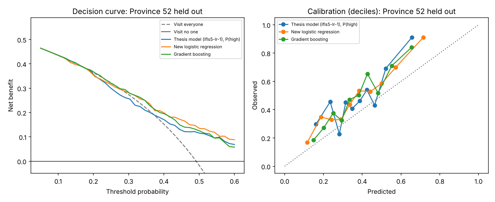

# Risk model: retraining results on IFLS5 (ifls5-lr-2)

The app now runs **ifls5-lr-2**, built here. The thesis model **ifls5-lr-1** is archived unchanged in
`backend/app/ai/riskModel/ifls5-lr-1/` and is the comparison throughout.

Data: IFLS5 (RAND, 2014–15), 4,794 children aged 0–59 months with a measured height, 4,299 households, 13 provinces
(no NTT). Built with `build_ifls5.py`. The IFLS data is not in this repository (RAND licence).

Target: stunting, HAZ < −2 (WHO 2006, computed with the app's own `growth.py`): 35.6% of the children.
Evaluation: the thesis's two settings, a household-grouped random 80/20 split and NTB (province 52) held out.
Survey weights: IFLS5 cross-section health-measurement weight (`pwt14usxa`). Capacity: Kader visit the top 30%.

Check of the extraction: on this table the thesis model (ifls5-lr-1) has AUC 0.692 for stunting (thesis: 0.681), and
the input means match the model's own scaling means (age 30.4 vs 29.5 months, birth weight 3,140 vs 3,134 g,
ANC 9.3 vs 9.2, education 2.44 vs 2.46). The thesis reports 5,202 children; this extraction keeps 4,794 (children
with a measured height, a birth date and |HAZ| ≤ 6).

## The model (ifls5-lr-2)

Logistic regression for stunting with:
- the thesis inputs without the district (every NTT district was unseen by ifls5-lr-1), ARI defined as cough **and**
  difficult breathing (IFLS5 morbidity module);
- five inputs a Kader can ask at registration, chosen before any results were seen: father's height, mother's age at
  the birth, birth order, children under 5 in the household, a 10-item asset checklist (own house, electricity, fridge,
  TV, gas/electric cooking, vehicle, savings, jewellery, land, another house);
- age as a cubic spline (5 knots), the other numeric inputs standardised, unknown values imputed with the training
  median (numeric) or most common value (0/1), L2 regularisation chosen by 5-fold household-grouped cross-validation,
  survey weights;
- levels: high if P(stunting) ≥ 0.4218 (the top 30% of the training children), medium if ≥ 0.2837 (top 60%), else low.
  Thresholds are fixed on the training data, so a higher-risk area gets more "high" children.

The app reproduces it exactly: 300 synthetic parity children, max difference 3.3 × 10⁻¹⁶, 0 level mismatches
(Python and JavaScript ports).

## Discrimination (AUC, 95% CI from 300 household resamples)

| Model | Random split (n = 975) | NTB held out (n = 456) |
|---|---|---|
| Thesis model (ifls5-lr-1) | 0.641 (0.596–0.681) | 0.674 (0.611–0.719) |
| **ifls5-lr-2** | **0.665 (0.622–0.711)** | **0.727 (0.675–0.774)** |
| Gradient boosting, same inputs | 0.655 (0.615–0.695) | 0.723 (0.672–0.765) |
| Rule: mother < 150 cm or birth weight < 2.5 kg | 0.581 (0.541–0.622) | 0.574 (0.517–0.622) |

The thesis model was trained on the random split of IFLS5, so some of these test children were in its training data
(all of NTB was available to it). Its figures here are optimistic; ifls5-lr-2's are not.

## Paired comparisons (same children, 1,000 household resamples; `compare.py`)

| Comparison (AUC difference, 95% CI) | Random split | NTB held out |
|---|---|---|
| Thesis model − rule | **+0.061** (+0.025 to +0.097) | **+0.100** (+0.060 to +0.141) |
| ifls5-lr-2 − rule | **+0.085** (+0.052 to +0.120) | **+0.152** (+0.113 to +0.195) |
| ifls5-lr-2 − same model without the five new inputs | **+0.024** (+0.007 to +0.040) | **+0.025** (+0.004 to +0.047) |
| ifls5-lr-2 − thesis model | +0.023 (−0.003 to +0.048) | **+0.052** (+0.022 to +0.082) |
| Same model without the five new inputs − thesis model | −0.001 (−0.022 to +0.019) | **+0.027** (+0.002 to +0.054) |

Bold: the 95% CI excludes zero.

## As deployed (thresholds fixed on the training data; `export_app_model.py`)

| Setting | Flagged high | Recall: stunted children flagged high (95% CI) | Precision | Accuracy | Brier | Calibration slope |
|---|---|---|---|---|---|---|
| Random split | 31.6% | 43.9% (37.9–49.9%) | 48.6% | 64.1% | 0.212 | 0.81 |
| NTB held out | 39.1% | 54.4% (48.3–60.8%) | 68.3% | 65.2% | 0.222 | 1.09 |

In NTB, where stunting is more common (49%), the fixed thresholds flag more children (39%) and catch more of the
stunted ones (54%).

Top inputs (drop in AUC when the input is unknown for every test child, random split): age, father's height, mother's
height, mother's education, household assets.



## A design decision: no missing-value flags

A variant with 0/1 "value missing" flags scored about the same (AUC 0.662 and 0.719; vs the thesis model +0.021 and
+0.044). It was rejected for the app: in the survey a value is missing for reasons that carry risk information (e.g.
the father was not there to be measured), in the app because nobody has asked yet. With flags, a child with no data
scored P(stunting) = 0.17, "low": false reassurance. Without flags such a child scores 0.34 ("medium") and goes to a
health worker for review. `train.py --missing-flags` reproduces the variant.

## What this supports

1. A model adds value over a simple checklist: both models rank children significantly better than "mother < 150 cm or
   birth weight < 2.5 kg", in both settings.
2. Inputs a Kader can collect at registration improve the model significantly in both settings (+0.024, +0.025).
3. ifls5-lr-2 generalises better to an unseen province: +0.052 AUC over the thesis model on NTB, which the thesis model
   had seen. On the random split the gain (+0.023) is not significant.
4. Gradient boosting is not better than logistic regression, so the interpretable model is the right choice.

## Limits (state these in the thesis)

- Discrimination is modest (AUC 0.67–0.73). Background factors cannot identify stunting precisely; the model prioritises
  visits, it does not diagnose. The WHO z-score rules on measured growth stay in charge.
- All models under-predict risk in NTB (calibration plot). NTT needs threshold recalibration on NTT children
  (`recalibrate.py`) before field use.
- Cross-sectional: the target is current stunting. Predicting future growth faltering needs repeated measurements.
- Immunisation comes only from the vaccination card in IFLS5 (78% unknown), so its effect is poorly estimated.
- IFLS5 is from 2014–15 and does not include NTT. Not a clinical validation.

## Reproduce

```bash
python ml/build_ifls5.py --dta /path/to/hh14_all_dta --out children.csv
python ml/train.py --data children.csv --holdout-province 52 --weight-col weight --capacity 0.30 --bootstrap 300 --out ml/out
python ml/compare.py --data children.csv --base-drop-extras --holdout-province 52 --weight-col weight
python ml/export_app_model.py --data children.csv --weight-col weight --out backend/app/ai/riskModel
node backend/app/ai/riskModel/parity_test.js
```
